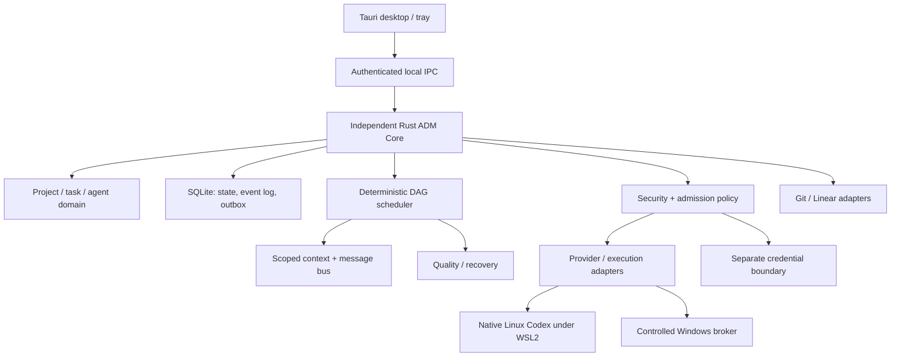

# Technical architecture

Status: approved architecture baseline for M00-03; planned design, not an implemented system. The 15 linked ADRs record selected decisions, rationale, limitations and roadmap ownership.

## Component model

The diagram is logical, not a process or trust-boundary proof. Core owns persistence and authorization; UI does not write the database directly. Runtime enforcement, trusted worker identity, IPC, credentials, protected Git metadata, Windows broker and sandbox require explicit threat modeling and tests.

## Data and execution flow

Approved plan revision -> validated dependency graph -> resource and permission admission -> scoped worktree/context -> provider session/run -> deterministic validation and required independent review -> integration candidate -> human acceptance when required -> controlled Git integration -> task finalization and external synchronization. Any required failure blocks downstream work; no agent can authorize its own rights. Local state, event and outbox changes are transactional where applicable. External side effects are reconciled separately, with explicit ambiguity handling.

Separate project, milestone, task, agent identity, session, execution run, quality gate and sync state models. A succeeded run is not a completed task; an externally completed task cannot waive internal gates. A synced status is not equivalent to verified integration. Detailed transition tables are implementation deliverables.

## Trust boundaries

Treat model output, project files, test output and external responses as untrusted. Enforce permissions in the core and execution environments rather than relying on instructions. Isolate credentials from ordinary agent workspaces; Windows execution is explicitly authorized, not a fallback. Scope context, Git refs, IPC and external effects. Persist global stop and cumulative budgets. See [system invariants](system-invariants.md) and [consolidation](consolidation.md).

## ADR index

| ADR | Decision |
| --- | --- |
| [ADR-001](decisions/adr-001-technology-stack.md) | Technology stack |
| [ADR-002](decisions/adr-002-hybrid-execution.md) | Hybrid execution |
| [ADR-003](decisions/adr-003-independent-core.md) | Independent modular core |
| [ADR-004](decisions/adr-004-persistence.md) | Persistence and event log |
| [ADR-005](decisions/adr-005-agent-identity.md) | Agent identity and sessions |
| [ADR-006](decisions/adr-006-scheduler.md) | Deterministic scheduler |
| [ADR-007](decisions/adr-007-hierarchical-context.md) | Hierarchical context |
| [ADR-008](decisions/adr-008-agent-communication.md) | Agent communication |
| [ADR-009](decisions/adr-009-layered-security.md) | Layered security |
| [ADR-010](decisions/adr-010-resources.md) | Resource and quota management |
| [ADR-011](decisions/adr-011-quality-gates.md) | Evidence-based quality gates |
| [ADR-012](decisions/adr-012-integrations.md) | Integration adapters |
| [ADR-013](decisions/adr-013-workspace.md) | Workspace architecture |
| [ADR-014](decisions/adr-014-recovery.md) | Recovery engine |
| [ADR-015](decisions/adr-015-distribution.md) | Distribution and extension strategy |

## Validation status

The feasibility phase was completed as an investigation, not production certification. Windows App Server communication and authenticated inference, independent session context, overlapping runs, process I/O and selected model/effort settings were demonstrated in controlled probes. Linux sandbox tests and Linear operations demonstrated partial feasibility. Neither these probes nor the architecture establish full end-to-end security or public provider eligibility.

Open gates: Rust/Tauri Windows build prerequisites, authenticated native Linux inference with account isolation, actual agent-mediated sandbox enforcement, concurrent profiles and host interop/IPC, complete process cancellation, real quota behavior, abrupt recovery, protected test evidence, durable Linear reconciliation, provider terms/public auth and signed distribution. Detailed sanitized evidence belongs to M00-04. No test secrets or raw transcripts in public documentation.

## Source-of-truth policy

Product decisions: versioned product specification. Architecture: ADRs and approved amendments. Execution rules: AGENTS.md and technical policies (M00-06). Progress: Linear (M00-07). Actual source and revision: Git. Evidence: reports bound to artifacts/commits. No chat summary overrides an approved versioned decision without review.
